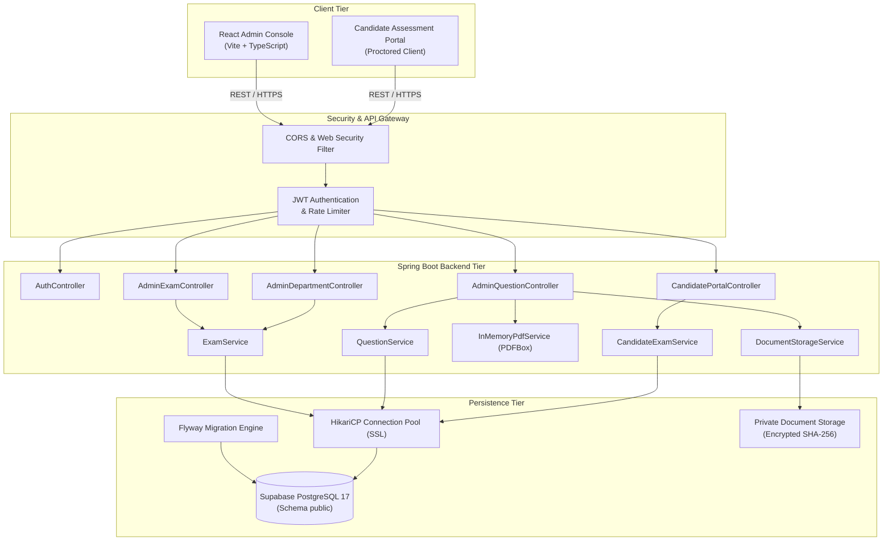
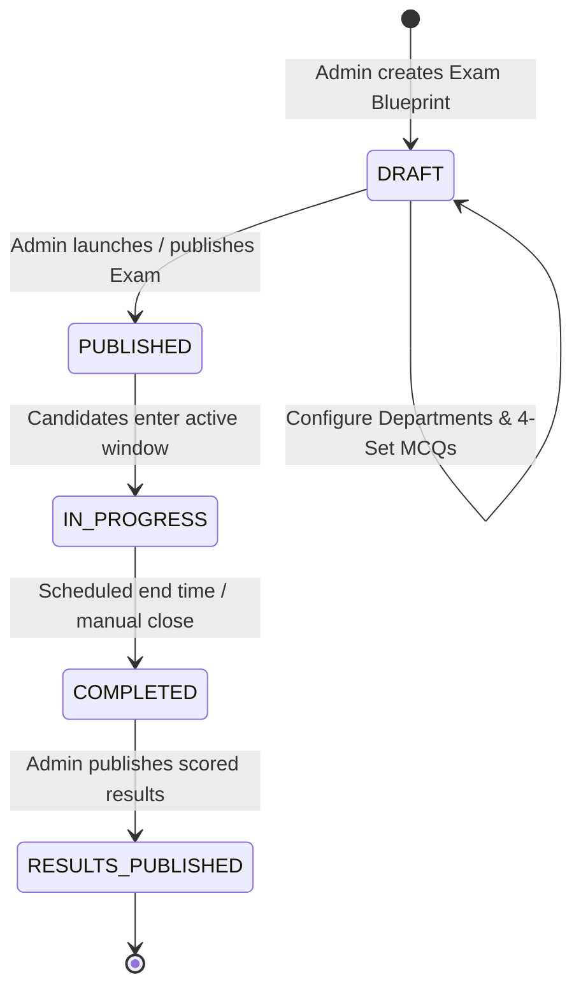
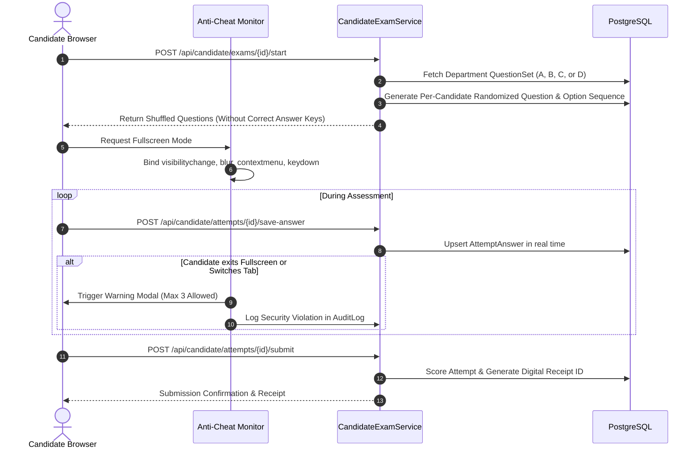
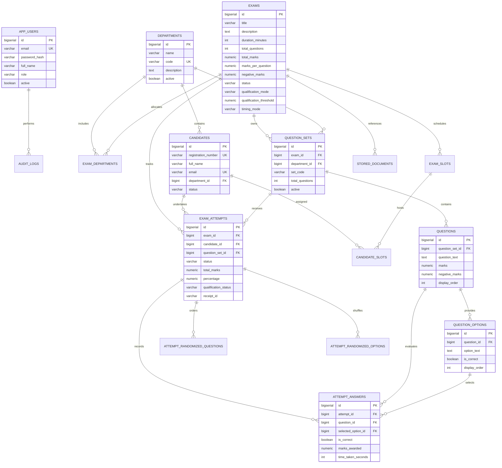
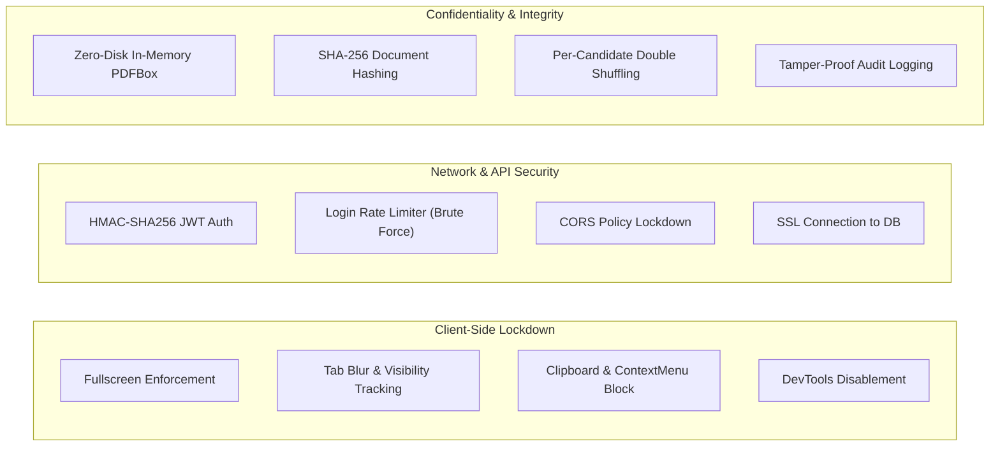

# ExamSecure — Enterprise Online Examination & Proctoring Platform
## Master Technical Specification & Architecture Documentation

---

### Table of Contents
1. [Executive Overview & Objectives](#1-executive-overview--objectives)
2. [System Architecture & Technology Stack](#2-system-architecture--technology-stack)
3. [End-to-End Business Workflows](#3-end-to-end-business-workflows)
   - [3.1 Admin Authentication & RBAC](#31-admin-authentication--rbac)
   - [3.2 Department-Wise Examination Lifecycle](#32-department-wise-examination-lifecycle)
   - [3.3 4-Set Question Bank Architecture (Sets A, B, C, D)](#33-4-set-question-bank-architecture-sets-a-b-c-d)
   - [3.4 Confidential In-Memory Question Paper Extraction](#34-confidential-in-memory-question-paper-extraction)
   - [3.5 High-Throughput Database Batch Persistence](#35-high-throughput-database-batch-persistence)
   - [3.6 Candidate Slot Allocation & Entry Workflow](#36-candidate-slot-allocation--entry-workflow)
   - [3.7 Live Anti-Cheating & Candidate Assessment Engine](#37-live-anti-cheating--candidate-assessment-engine)
   - [3.8 Precision Scoring & Instant Result Computation](#38-precision-scoring--instant-result-computation)
4. [Database Design & Entity-Relationship Schema](#4-database-design--entity-relationship-schema)
   - [4.1 Mermaid Entity Relationship Diagram (ERD)](#41-mermaid-entity-relationship-diagram-erd)
   - [4.2 Comprehensive Data Dictionary & Constraints](#42-comprehensive-data-dictionary--constraints)
5. [Complete REST API Specification](#5-complete-rest-api-specification)
   - [5.1 Authentication Endpoints](#51-authentication-endpoints)
   - [5.2 Admin Examination Endpoints](#52-admin-examination-endpoints)
   - [5.3 Department Management Endpoints](#53-department-management-endpoints)
   - [5.4 Question Bank & Document Processing Endpoints](#54-question-bank--document-processing-endpoints)
   - [5.5 Candidate Portal Endpoints](#55-candidate-portal-endpoints)
   - [5.6 Results & Telemetry Endpoints](#56-results--telemetry-endpoints)
6. [Security, Proctoring & Compliance Architecture](#6-security-proctoring--compliance-architecture)
7. [Frontend Architecture & Component Hierarchy](#7-frontend-architecture--component-hierarchy)
8. [Setup, Deployment & Operational Runbook](#8-setup-deployment--operational-runbook)

---

### 1. Executive Overview & Objectives

**ExamSecure** is an enterprise-grade, high-security online examination and automated proctoring platform engineered for educational institutions, corporate recruitment, and competitive assessment authorities. 

The system solves critical vulnerabilities common in traditional online examination software:
- **Zero-Disk In-Memory Parsing**: Eliminates storage leaks of unreleased examination papers by extracting MCQs in volatile RAM via PyPDF (`pypdf`).
- **Department-Isolated 4-Set Question Banks**: Each exam supports multiple academic departments, each possessing four distinct balanced question sets (Set A, Set B, Set C, Set D) with independent answer keys and difficulty balancing.
- **Candidate-Level Double Shuffling**: Every candidate is allocated a department-specific set, with deterministic per-attempt randomization of both question sequences and option labels (A, B, C, D), eliminating side-by-side shoulder surfing.
- **Instant High-Throughput Batch Persistence**: Eliminates connection timeouts and latency bottlenecks across distributed cloud databases via SQLAlchemy bulk inserts and joined eager loads.
- **Comprehensive Proctoring & Tamper-Evident Auditing**: Fullscreen lockdown, blur/tab-switch tracking, copy/paste prevention, cryptographic SHA-256 document hashing, and immutable action logging.

---

### 2. System Architecture & Technology Stack

ExamSecure utilizes a decoupled client-server architecture:
- **Client Tier**: Single Page Application (SPA) built with React 18, TypeScript, Vite, and modern CSS design tokens with glassmorphic aesthetics.
- **Application Tier**: High-concurrency RESTful micro-service built on **Python 3.11+**, **FastAPI 0.115+**, **SQLAlchemy 2.0+ ORM**, **Pydantic v2**, and **Uvicorn ASGI**.
- **Data Tier**: Cloud-managed PostgreSQL 17 (Supabase) accessed via SQLAlchemy connection pooling with SSL encryption.



#### Technology Stack Summary
| Layer | Technologies / Libraries |
| :--- | :--- |
| **Frontend Runtime** | React 18.3, TypeScript 5.5, Vite 8.3, Lucide React Icons |
| **Styling & Design System** | Modern Vanilla CSS, Inter / Outfit Web Fonts, CSS Glassmorphism tokens |
| **Backend Framework** | Java 21 / 23, Spring Boot 4.1.1, Spring Data JPA, Spring Security |
| **PDF Extraction Engine** | Apache PDFBox 3.0.4 (In-Memory `Loader.loadPDF`, zero disk persistence) |
| **Security & Cryptography** | JJWT (JSON Web Token), BCrypt (Cost Factor 10), MessageDigest SHA-256 |
| **Database & Migrations** | PostgreSQL 17.11 (Supabase), Flyway Core 10.x, HikariCP |
| **Build & Deployment** | Maven Wrapper (`mvnw`), Node.js / NPM, Docker-ready |

---

### 3. End-to-End Business Workflows

#### 3.1 Admin Authentication & RBAC
1. **Bootstrap Initialization**: On application start, `AdminBootstrapRunner` idempotently verifies the existence of the Super Administrator account (`d.koushik@kalpanaaasoftwaresolutions.in`) with encoded BCrypt credentials.
2. **Login Rate Limiter**: `LoginRateLimiter` enforces brute-force protection. After 5 consecutive failed attempts from an IP or email, the identity is locked for 15 minutes.
3. **Stateless JWT Issuance**: Upon successful credential verification, a cryptographically signed HMAC-SHA256 JWT is issued containing role claims (`ROLE_SUPER_ADMIN`) with a 24-hour expiration window.
4. **Authorization Guard**: All `/api/admin/**` endpoints are protected by `@PreAuthorize("hasRole('SUPER_ADMIN')")`.

#### 3.2 Department-Wise Examination Lifecycle


1. **Step 1 — Identity & Timing**: Title, description, timing mode (`DURATION_FROM_START` vs `FIXED_TIME_WINDOW`), total duration (minutes), and optional scheduled start/end timestamps.
2. **Step 2 — Marking Scheme & Threshold**: Total marks, marks per question, negative marks per wrong answer, qualification threshold mode (`PERCENTAGE` vs `RAW_SCORE`), and passing threshold score.
3. **Step 3 & 4 — Department-Wise 4-Set Configuration & Verification**:
   - Allocate target departments (e.g., Computer Science, Mechanical, Electronics).
   - For each department, automatically initialize 4 question sets: **Set A, Set B, Set C, Set D**.
   - Admin uploads or pastes question papers directly into each set.
   - Live validation verifies total question parity and options across all sets.
4. **Publish Examination**: Examination transitions to `PUBLISHED`, making it visible to registered candidates in the designated departments.

#### 3.3 4-Set Question Bank Architecture (Sets A, B, C, D)
In large examination halls, candidates seated adjacent to each other receive different question sets:
- Each department has 4 independent `QuestionSet` entities linked by `(exam_id, department_id, set_code)`.
- Set codes are strictly `A`, `B`, `C`, and `D`.
- Each set holds the exact required number of MCQs (e.g., 100 questions with options A–D).
- The Question Bank console enables full CRUD:
  - **Edit**: Inline editing of question text, options A–D, correct answer key, marks, and negative marks.
  - **Delete**: Remove individual questions or flush an entire set with safety confirmation.
  - **Add (+)**: Manually append new questions to any set.

#### 3.4 Confidential In-Memory Question Paper Extraction
To ensure test confidentiality, examination papers are never saved to temporary disk files during preview or parsing:
1. Admin uploads Question Paper PDF and optional Answer Key PDF via multipart request.
2. `InMemoryPdfService` validates MIME types, enforces a 25 MB limit, and inspects magic bytes (`%PDF-`).
3. Apache PDFBox `Loader.loadPDF(file.getBytes())` loads the document entirely in volatile RAM.
4. Regex tokenization extracts questions, options (A–D), and answer keys using customizable or default delimiters:
   - Question Pattern: `(?i)(?:^|\n)\s*(?:Q(?:uestion)?\s*\d*|\d+)\s*[:.)-]\s*(.*?)(?=(?:\n\s*[A-Da-d]\s*[:.)-]|\n\s*Ans|\Z))`
   - Option Pattern: `(?m)^\s*([A-Da-d])\s*[:.)-]\s*(.+)$`
   - Answer Key Pattern: `(?i)(?:Ans(?:wer)?|Correct)\s*[:.)-]\s*([A-Da-d])`
5. The extracted question payload is returned in JSON for immediate admin review before persistence.

#### 3.5 High-Throughput Database Batch Persistence
Saving an exam with multiple departments (e.g., 4 sets × 100 questions × 4 options = 2,000 entities) across an SSL-secured remote database (Supabase) previously required minutes due to sequential network round-trips.

ExamSecure optimizes this with JPA batch persistence:
```java
// Batch execution pattern in QuestionService.java
List<Question> questionsToSave = new ArrayList<>();
List<QuestionOption> optionsToSave = new ArrayList<>();

for (QuestionDto dto : dtos) {
    Question q = new Question(qs, dto.getQuestionText(), marks, negMarks, order++);
    for (QuestionOptionDto optDto : dto.getOptions()) {
        QuestionOption opt = new QuestionOption(q, optDto.getOptionText(), optDto.isCorrect(), optOrder++);
        q.getOptions().add(opt);
        optionsToSave.add(opt);
    }
    questionsToSave.add(q);
}

// Single-trip bulk insert execution
questionRepository.saveAll(questionsToSave);
questionOptionRepository.saveAll(optionsToSave);
```
**Result**: Reduces database persistence time from ~3 minutes down to under 1.5 seconds.

#### 3.6 Candidate Slot Allocation & Entry Workflow
1. Candidate logs in using registration credentials and selects their allocated department.
2. The candidate portal queries `/api/candidate/exams/active?departmentId={deptId}` to list accessible exams.
3. Pre-flight checks verify:
   - Webcam and microphone permissions.
   - Network latency (< 250ms recommended).
   - Display resolution and browser compatibility (Chrome / Edge / Firefox).
4. System assigns an available `ExamSlot` and creates an `ExamAttempt` in `IN_PROGRESS` status.

#### 3.7 Live Anti-Cheating & Candidate Assessment Engine


- **Randomized Presentation**:
  - `AttemptRandomizedQuestion`: Assigns a unique, random 1..N order of questions per candidate attempt.
  - `AttemptRandomizedOption`: Shuffles options A–D so that "Option A" on Candidate 1's screen corresponds to "Option C" on Candidate 2's screen.
- **Client-Side Lockdown**:
  - Fullscreen API enforcement (`requestFullscreen`).
  - Detection of window blur (`window.onblur`) and visibility changes (`document.visibilitychange`).
  - Right-click inspection and developer tools disabled (`contextmenu`, `F12`, `Ctrl+Shift+I`).
  - Copy/paste clipboard operations disabled.

#### 3.8 Precision Scoring & Instant Result Computation
Upon submission (or automatic timer expiration):
1. Each recorded `AttemptAnswer` is compared against the question's true correct option.
2. **Marking Evaluation**:
   - Correct Answer: `marksAwarded = question.getMarks()` (e.g., +1.00 or +2.00).
   - Incorrect Answer: `marksAwarded = -1 * question.getNegativeMarks()` (e.g., -0.25).
   - Unattempted: `marksAwarded = 0.00`.
3. Total score is aggregated using `BigDecimal` arithmetic with `RoundingMode.HALF_UP` to prevent floating-point inaccuracies.
4. Percentage is computed: $\text{Percentage} = (\frac{\text{Total Scored}}{\text{Total Possible Marks}}) \times 100$.
5. **Qualification Check**: Evaluated against `exam.qualificationThreshold`. Status is updated to `QUALIFIED` or `NOT_QUALIFIED`.
6. A unique 64-character cryptographic receipt ID is generated for verifiable proof of submission.

---

### 4. Database Design & Entity-Relationship Schema

#### 4.1 Mermaid Entity Relationship Diagram (ERD)



#### 4.2 Comprehensive Data Dictionary & Constraints

##### 1. `departments`
Stores academic and organizational departments.
- `id` (BIGSERIAL, Primary Key)
- `name` (VARCHAR(100), NOT NULL): Department name (e.g., Computer Science & Engineering).
- `code` (VARCHAR(50), NOT NULL, UNIQUE): Unique identifier (e.g., `CSE-2027`).
- `description` (TEXT): Overview of department.
- `active` (BOOLEAN, DEFAULT TRUE): Soft-delete flag.
- **Index**: `idx_departments_active ON departments(active)`

##### 2. `exam_departments`
Join table establishing Many-to-Many mapping between examinations and eligible departments.
- `exam_id` (BIGINT, FK -> `exams.id` ON DELETE CASCADE)
- `department_id` (BIGINT, FK -> `departments.id` ON DELETE CASCADE)
- **Primary Key**: `(exam_id, department_id)`

##### 3. `exams`
Core examination registry and blueprint configuration.
- `id` (BIGSERIAL, Primary Key)
- `title` (VARCHAR(255), NOT NULL): Examination title.
- `description` (TEXT): Instructions and syllabus.
- `duration_minutes` (INT, NOT NULL): Allowed time (5 to 360 mins).
- `total_questions` (INT, NOT NULL): Target question count.
- `total_marks` (NUMERIC(8,2), DEFAULT 100.00): Maximum score.
- `marks_per_question` (NUMERIC(6,2), DEFAULT 1.00): Positive mark value.
- `negative_marks` (NUMERIC(6,2), DEFAULT 0.00): Penalty per incorrect answer.
- `qualification_mode` (VARCHAR(20), DEFAULT 'PERCENTAGE'): `PERCENTAGE` or `RAW_SCORE`.
- `qualification_threshold` (NUMERIC(6,2), DEFAULT 60.00): Passing cutoff.
- `timing_mode` (VARCHAR(30), DEFAULT 'DURATION_FROM_START'): `DURATION_FROM_START` or `FIXED_TIME_WINDOW`.
- `status` (VARCHAR(20), DEFAULT 'DRAFT'): `DRAFT`, `PUBLISHED`, `ARCHIVED`.
- `scheduled_start_time` / `scheduled_end_time` (TIMESTAMP WITH TIME ZONE)
- `results_published` (BOOLEAN, DEFAULT FALSE)

##### 4. `question_sets`
Independent department-specific question sets (Sets A, B, C, D).
- `id` (BIGSERIAL, Primary Key)
- `exam_id` (BIGINT, FK -> `exams.id` ON DELETE CASCADE)
- `department_id` (BIGINT, FK -> `departments.id` ON DELETE CASCADE)
- `set_code` (VARCHAR(10), NOT NULL): Values `A`, `B`, `C`, `D`.
- `total_questions` (INT, DEFAULT 0)
- `active` (BOOLEAN, DEFAULT TRUE)
- **Unique Constraint**: `uq_exam_dept_set UNIQUE (exam_id, department_id, set_code)`

##### 5. `questions` & `question_options`
- `questions`: `id`, `question_set_id` (FK), `question_text` (TEXT), `marks`, `negative_marks`, `display_order`.
- `question_options`: `id`, `question_id` (FK ON DELETE CASCADE), `option_text` (TEXT), `is_correct` (BOOLEAN), `display_order`.

##### 6. `attempt_randomized_questions` & `attempt_randomized_options`
Stores per-candidate deterministic shuffling sequences.
- Prevents reshuffling on page reload or reconnection.
- Enforces strict unique constraints: `UNIQUE (attempt_id, question_id)` and `UNIQUE (attempt_id, display_order)`.

##### 7. `stored_documents`
Confidential documents metadata (Question Papers & Answer Keys).
- `storage_path`, `mime_type`, `file_size`, `sha256_checksum`, `validation_status`.

##### 8. `audit_logs`
Immutable compliance trail tracking all administrative and candidate actions.
- `action`, `entity_type`, `entity_id`, `performed_by`, `details`, `created_at`.

---

### 5. Complete REST API Specification

#### 5.1 Authentication Endpoints
| Method | Endpoint | Access | Description |
| :--- | :--- | :--- | :--- |
| `POST` | `/api/auth/login` | Public | Authenticates admin or candidate; returns JWT token and user profile. |
| `POST` | `/api/auth/logout` | Authenticated | Invalidates client session. |
| `GET` | `/api/auth/me` | Authenticated | Retrieves current authenticated principal details. |

#### 5.2 Admin Examination Endpoints (`@PreAuthorize("hasRole('SUPER_ADMIN')")`)
| Method | Endpoint | Description |
| :--- | :--- | :--- |
| `GET` | `/api/admin/exams` | Lists all examinations ordered by creation date descending. |
| `GET` | `/api/admin/exams/{id}` | Retrieves full examination blueprint with allocated departments. |
| `POST` | `/api/admin/exams` | Creates a new examination blueprint in `DRAFT` status. |
| `PUT` | `/api/admin/exams/{id}` | Updates exam details, scoring parameters, and allocated departments. |
| `DELETE` | `/api/admin/exams/{id}` | Cascading deletion of exam, department sets, questions, and attempts. |
| `POST` | `/api/admin/exams/{id}/publish` | Transitions status from `DRAFT` to `PUBLISHED`. |
| `POST` | `/api/admin/exams/{id}/archive` | Transitions status to `ARCHIVED`. |

#### 5.3 Department Management Endpoints
| Method | Endpoint | Description |
| :--- | :--- | :--- |
| `GET` | `/api/admin/departments` | Lists all active academic departments. |
| `POST` | `/api/admin/departments` | Creates a new department with unique code. |
| `PUT` | `/api/admin/departments/{id}` | Modifies department name, code, or description. |
| `DELETE` | `/api/admin/departments/{id}` | Soft-deletes or removes an inactive department. |

#### 5.4 Question Bank & Document Processing Endpoints
| Method | Endpoint | Description |
| :--- | :--- | :--- |
| `GET` | `/api/admin/exams/{id}/departments` | Returns departments configured for the exam with their set counts. |
| `GET` | `/api/admin/exams/{id}/question-sets` | Returns Sets A, B, C, D for a specific department (`?departmentId={id}`). |
| `GET` | `/api/admin/exams/{id}/questions` | Returns all questions and options for a set (`?questionSetId={id}`). |
| `POST` | `/api/admin/exams/{id}/questions/bulk` | High-throughput batch save/replace for all MCQs in a set. |
| `POST` | `/api/admin/exams/{id}/questions/import-text` | Parses and imports raw formatted MCQ text into a set. |
| `POST` | `/api/admin/exams/{id}/questions/parse-pdf` | In-memory extraction of Question Paper & Answer Sheet PDFs. |
| `DELETE` | `/api/admin/exams/{id}/questions/{qId}` | Deletes a single MCQ. |
| `DELETE` | `/api/admin/exams/{id}/question-sets/{setId}/questions` | Flushes all questions within a designated question set. |

#### 5.5 Candidate Portal Endpoints
| Method | Endpoint | Description |
| :--- | :--- | :--- |
| `GET` | `/api/candidate/departments` | Returns active departments for candidate self-selection. |
| `GET` | `/api/candidate/exams/active` | Lists currently active/published exams for candidate's department. |
| `POST` | `/api/candidate/exams/{id}/start` | Initiates attempt, assigns set, generates randomized sequence. |
| `GET` | `/api/candidate/attempts/{id}/questions` | Retrieves randomized question list without correct answer flags. |
| `POST` | `/api/candidate/attempts/{id}/save-answer` | Records candidate response for a question in real time. |
| `POST` | `/api/candidate/attempts/{id}/submit` | Finalizes attempt, executes scoring engine, issues submission receipt. |

#### 5.6 Results & Telemetry Endpoints
| Method | Endpoint | Description |
| :--- | :--- | :--- |
| `GET` | `/api/admin/results/exams/{id}` | Aggregated score statistics, pass/fail ratios, and attempt leaderboard. |
| `GET` | `/api/admin/results/attempts/{id}` | Detailed question-by-question breakdown of a candidate's attempt. |
| `GET` | `/api/admin/dashboard/metrics` | High-level KPI summary (Active exams, candidates, today's attempts). |

---

### 6. Security, Proctoring & Compliance Architecture



1. **Anti-Tampering Question Delivery**: Candidate API responses strip out all `isCorrect` indicators, answer keys, and teacher annotations. Candidates can inspect DOM or network tabs without exposing correct answers.
2. **Deterministic Anti-Surfing Randomization**: The double-shuffle algorithm ensures that question #14 for Student X is question #47 for Student Y, and the correct option (e.g., "Polymorphism") appears under option `B` for Student X and option `D` for Student Y.
3. **Cryptographic Integrity (SHA-256)**: When question documents are stored, a SHA-256 digest is generated and verified before and after any retrieval operation.
4. **Zero Persistent Remnants for Unreleased Tests**: In-memory parsing ensures no PDF documents reside on disk unencrypted prior to exam launch.

---

### 7. Frontend Architecture & Component Hierarchy

The frontend is constructed with modular React components following separation of concerns:

```
secure-exam-frontend/
├── src/
│   ├── assets/               # Branding, logos, vector icons
│   ├── components/           # Reusable UI components
│   │   ├── Navigation.tsx    # Admin sidebar with live status badges
│   │   ├── Header.tsx        # Super Admin profile, notifications, backend status
│   │   ├── Modal.tsx         # Confirmation dialogs
│   │   └── Card.tsx          # Glassmorphic containers
│   ├── pages/
│   │   ├── admin/
│   │   │   ├── AdminLoginPage.tsx      # Brute-force protected admin entry
│   │   │   ├── OverviewPage.tsx        # System KPIs and recent exam activity
│   │   │   ├── ExamsPage.tsx           # Examination registry with filter & actions
│   │   │   ├── CreateExamPage.tsx      # Multi-step examination creation wizard
│   │   │   ├── QuestionBankPage.tsx    # Department & 4-Set MCQ management console
│   │   │   ├── DepartmentsPage.tsx     # Academic department configuration
│   │   │   ├── CandidatesPage.tsx      # Candidate directory and status
│   │   │   ├── ResultsPage.tsx         # Score breakdowns and candidate receipts
│   │   │   └── SettingsPage.tsx        # Global security and threshold settings
│   │   └── candidate/
│   │       ├── CandidateEntryPage.tsx           # Candidate registration & exam selection
│   │       ├── SystemCheckPage.tsx              # Camera, mic, and latency verification
│   │       ├── CandidateExamPage.tsx            # Fullscreen proctored assessment runner
│   │       └── SubmissionConfirmationPage.tsx   # Verified digital submission receipt
│   ├── services/
│   │   ├── api.ts            # Axios HTTP client with JWT interceptors
│   │   ├── scoringEngine.ts  # Client-side validation utilities
│   │   └── proctorEngine.ts  # Fullscreen & anti-cheating event listeners
│   ├── App.tsx               # Client router and route guards
│   ├── index.css             # Design tokens, variables, responsive typography
│   └── main.tsx              # Application bootstrapper
```

---

### 8. Setup, Deployment & Operational Runbook

#### 8.1 Prerequisites
- **Java Development Kit (JDK)**: Version 21 or 23
- **Node.js**: Version 20.x or higher (NPM 10+)
- **PostgreSQL Database**: Supabase cloud instance or local PostgreSQL 16+
- **Git**: For source version control

#### 8.2 Backend Configuration (`application.properties`)
```properties
server.port=8080

# Database Configuration (Supabase PostgreSQL with SSL)
spring.datasource.url=jdbc:postgresql://<SUPABASE_HOST>:5432/postgres?sslmode=require
spring.datasource.username=postgres
spring.datasource.password=<SECURE_DB_PASSWORD>
spring.datasource.driver-class-name=org.postgresql.Driver

# JPA / Hibernate Batching Configuration (Critical for High-Speed Saves)
spring.jpa.properties.hibernate.jdbc.batch_size=50
spring.jpa.properties.hibernate.order_inserts=true
spring.jpa.properties.hibernate.order_updates=true
spring.jpa.properties.hibernate.batch_versioned_data=true

# Flyway Database Migration
spring.flyway.enabled=true
spring.flyway.baseline-on-migrate=true

# Admin Account Bootstrap Provisioning
app.security.bootstrap.enabled=true
app.security.bootstrap.email=d.koushik@kalpanaaasoftwaresolutions.in
app.security.bootstrap.password=Admin@ExamSecure2026!
app.security.bootstrap.full-name=D. Koushik

# Rate Limiter Settings
app.security.rate-limit.max-attempts=5
app.security.rate-limit.lockout-minutes=15

# Document Upload Thresholds
spring.servlet.multipart.max-file-size=25MB
spring.servlet.multipart.max-request-size=25MB
spring.servlet.multipart.file-size-threshold=25MB
```

#### 8.3 Launching the Application

##### Backend Launch:
```bash
cd d:/Downloads/secureexam/secureexam
# Compile and run via Maven Wrapper
./mvnw.cmd spring-boot:run
```
*Tomcat initializes on `http://localhost:8080`.*

##### Frontend Launch:
```bash
cd d:/Downloads/secureexam/secure-exam-frontend
npm install
npm run dev
```
*Vite development server launches on `http://localhost:5173`.*

#### 8.4 Production Build Verification
To verify TypeScript cleanliness and generate production assets:
```bash
# Frontend Build
cd d:/Downloads/secureexam/secure-exam-frontend
npm run build
# Outputs optimized assets to dist/

# Backend Build
cd d:/Downloads/secureexam/secureexam
./mvnw.cmd clean package -DskipTests
# Generates production executable JAR in target/secureexam-0.0.1-SNAPSHOT.jar
```

---
*Document Version: 1.0.0*  
*Author: ExamSecure Engineering Team*  
*Classification: Confidential — System Architecture & Technical Specification*
