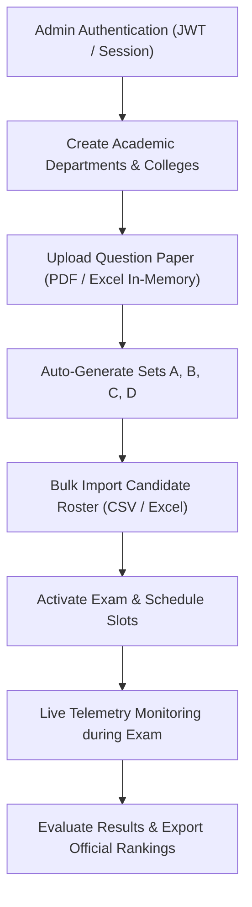
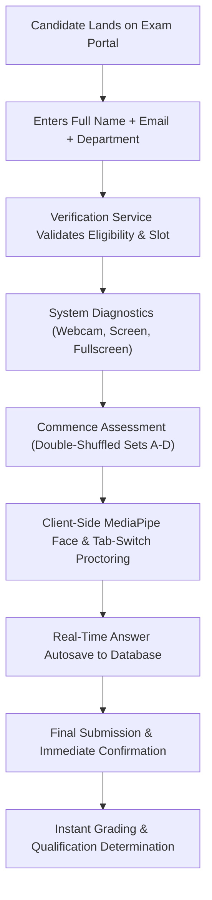
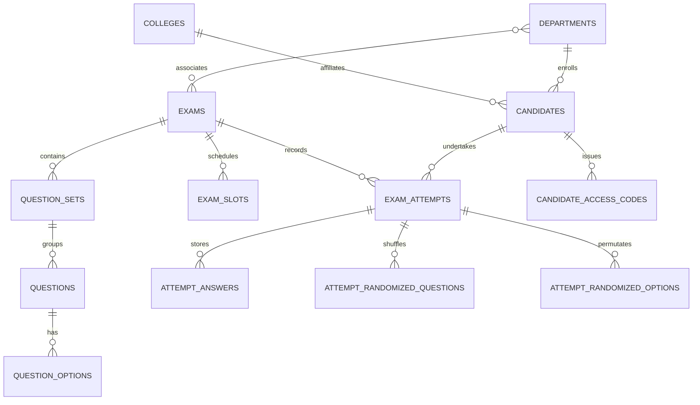

# Product Requirement Document (PRD)
# ExamSecure — Enterprise Online Examination & Proctoring Platform

---

## Document Control & Metadata

| Attribute | Details |
|---|---|
| **Product Name** | **ExamSecure Enterprise** (KSS Exam Platform) |
| **Product Version** | **2.4.0** |
| **Document Version** | **1.1.0 (MCQ Assessment Edition)** |
| **Document Status** | **Approved / Active Production** |
| **Product Owner** | Kalpanaa Software Solutions (KSS-Official) |
| **Target Scale** | 500 – 1,500 Concurrent Active Candidates per Slot |
| **Deployment Mode** | Hybrid Cloud (Vercel Pro Frontend + FastAPI Backend + Neon Postgres Pro) |
| **Last Updated** | November 2026 |

---

## 1. Executive Summary & Vision

### 1.1 Problem Statement
Traditional online examination software suffers from four fundamental architectural flaws:
1. **Security & Question Paper Leaks**: Uploaded examination question papers are stored unencrypted on server disks, susceptible to file exposure or insider leaks.
2. **Shoulder Surfing & Physical Cheating**: Adjacent candidates in campus lab halls share identical question papers, making side-by-side cheating trivial.
3. **Database Concurrency Bottlenecks**: When 500+ candidates hit "Submit" or autosave answers simultaneously, standard database connections exhaust, resulting in HTTP 504 Gateway Timeouts and lost submissions.
4. **Proctoring Bandwidth & Hardware Inefficiencies**: Server-side video-stream AI proctoring consumes vast cloud GPU bandwidth ($0.05/minute/user), crashing campus Wi-Fi networks and driving operational bills above ₹1,00,000 per exam.

### 1.2 Product Vision
**ExamSecure** is a high-concurrency, zero-disk, double-randomized online examination and proctoring ecosystem designed for university campus drives, institutional testing, and competitive recruitment.

The platform provides a secure, streamlined assessment lifecycle:
- **Zero-Disk In-Memory Question Paper Parsing**: Ingests PDF, Word, and Excel question papers in volatile RAM without saving unreleased test papers to permanent disk.
- **Double-Shuffled 4-Set Architecture (Sets A, B, C, D)**: Candidate-specific randomization of both question sequences and option labels (A, B, C, D), eliminating shoulder surfing.
- **Client-Side AI Face Proctoring**: Real-time face tracking via MediaPipe WebAssembly (WASM) and BlazeFace neural network executing 100% inside the candidate's browser with zero server video streaming cost.
- **Sub-150ms Answer Autosave & Precision Scoring**: High-throughput database connection pooling via Neon pgBouncer with automated instant score evaluation.

---

## 2. Product Goals, KPIs & Non-Goals

### 2.1 Key Business & Technical Goals
- **Zero-Disk In-Memory Paper Processing**: Parse and validate question papers in volatile RAM without persisting unreleased question paper files on disk.
- **Sub-150ms Answer Autosave**: Real-time per-question answer persistence with in-memory caching to eliminate submission bottlenecks during 800-candidate spikes.
- **Sub-₹1.50 Infrastructure Cost per Candidate**: Client-side execution of AI proctoring models via WebAssembly (WASM) to eliminate server video streaming costs.
- **100% Deterministic Anti-Cheating**: Candidate-specific randomization of both question sequences and option labels (A, B, C, D).

### 2.2 Success Metrics (KPIs)
- **Zero Data Loss**: 100.00% answer capture across transient device disconnects or browser refreshes.
- **Peak Concurrency Latency**: P99 response time `< 200 ms` at 500 simultaneous active test takers.
- **Proctoring Accuracy**: `< 0.5%` false-positive rate on face detection and tab-switch telemetry.
- **Result Finalization**: Instant scoring within `< 5 seconds` of final exam submission.

### 2.3 Non-Goals
- Native desktop agent installations (ExamSecure is 100% zero-install web-native).
- Full remote video call proctoring (replaced by low-bandwidth client-side facial landmark analysis).
- In-browser code compilers or IDE runtimes (focused exclusively on comprehensive objective assessments).

---

## 3. Target Personas & Stakeholders

| Persona | Role | Key Needs & Pain Points |
|---|---|---|
| **Super Administrator** | Exam Director / Head of HR | Needs centralized visibility, exam lifecycle control (Draft → Published → Activated → Closed), college/department oversight, and tamper-evident audit trails. |
| **Exam Evaluator / Reviewer** | College Professor / Hiring Manager | Needs department-specific candidate performance dashboards, score distributions, and 1-click candidate shortlisting and export. |
| **Candidate (Student / Applicant)** | Test Taker | Needs zero-friction login with Name/Email, auto-saving of answers, high-contrast accessible UI, and immediate device compatibility feedback. |
| **System Administrator / DevOps** | Infrastructure Engineer | Needs connection-pooled PostgreSQL, auto-scaling compute, and health monitoring telemetry. |

---

## 4. End-to-End User Journeys

### 4.1 Administrator Journey

### 4.2 Candidate Assessment Journey

---

## 5. Functional Requirements (FR)

### FR-1: Multi-Tenant Hierarchy (Colleges & Departments)
- **1.1 College Management**: Support creation of multiple colleges with unique name, institutional code, and description.
- **1.2 Department Management**: Support technical and non-technical academic tracks (e.g., *Software Developer*, *QA*, *AI/ML*, *Sales & Marketing*, *HR*).
- **1.3 Dynamic Department Mapping**: Automatic classification of candidates into `TECHNICAL` vs. `NON_TECHNICAL` based on department category tags for tailored assessment routing.

### FR-2: Candidate Management & Bulk Ingestion
- **2.1 Manual Registration**: Admin registration form with auto-defaulting of `exam_date` to current date and default `batch` to `Slot 1` to enable immediate testing.
- **2.2 Bulk Roster Ingestion**: Upload engine supporting CSV, Excel (`.xlsx`, `.xls`), Word (`.docx`), and PDF roster documents.
- **2.3 Fuzzy Column Header Mapping**: Automatic regex detection for variable roster headers:
  - *Registration Number*: `Reg No`, `Sl. No.`, `Roll No`, `Student ID`.
  - *Full Name*: `Name`, `Candidate Name`, `Student Name`.
  - *Email*: Validated via RFC 5322 regex.
  - *College / Department*: Auto-mapped to registered institutions.
- **2.4 Conflict Resolution**: Re-imports update existing records without creating duplicate candidate accounts (`ON CONFLICT (email) DO UPDATE`).

### FR-3: In-Memory Question Paper Extraction (Zero-Disk Storage)
- **3.1 Volatile Processing**: Question papers uploaded in PDF format are processed entirely in memory via `pypdf`/`PyMuPDF` and parsed into structured MCQ entities without saving binary files to persistent disks.
- **3.2 Automated Question Structure Parsing**: Extract question text, mark weightage, display sequence, and individual choices labeled A through D.
- **3.3 Answer Key Ingestion**: Support dual-document upload (Question Paper PDF + Separate Answer Key CSV/PDF) with automated key-to-question association.

### FR-4: 4-Set Question Bank & Double-Randomization Architecture
- **4.1 4-Set Independence**: Each exam automatically provisions four parallel question sets: **Set A, Set B, Set C, Set D**.
- **4.2 Question Sequence Shuffling**: Per-candidate deterministic pseudo-random shuffling of question ordering stored in `attempt_randomized_questions`.
- **4.3 Option Label Permutation**: Dynamic shuffling of option display labels (A, B, C, D) per question per attempt stored in `attempt_randomized_options`. The underlying correct answer ID remains fixed in backend evaluation.
- **4.4 Answer Mapping**: Candidate responses are submitted referencing the randomized option ID; the backend resolves it to the master question option to prevent option-tampering.

### FR-5: Candidate Verification & Entry Controls
- **5.1 Single-Identifier Verification**: Candidates verify entry via their registered Full Name and Email Address.
- **5.2 Automated Time Gates**: Configurable entry gates:
  - *Slot 1 Window*: Opens at scheduled morning slot.
  - *Slot 2 Window*: Opens at scheduled afternoon slot.
  - *Gate Override*: When `ENFORCE_SLOT_TIME_GATES=false`, candidates can enter the exam at any time for practice, testing, or flexible schedule windows.
- **5.3 Fail-Safe Auto-Allocation**: Newly registered candidates without pre-assigned sets or dates are automatically granted access to the currently active exam on Set A.

### FR-6: Anti-Cheating & AI Client-Side Proctoring Engine
- **6.1 MediaPipe WebAssembly Face Tracking**:
  - Integrated BlazeFace Short-Range neural network running inside browser WASM (`blaze_face_short_range.tflite`).
  - Real-time face presence tracking (frequency: 1 evaluation every 2,000 ms).
  - Triggers alerts for: *No face detected*, *Multiple faces detected*, or *Face tilted away from screen*.
- **6.2 Fullscreen Lockdown**: Forces standard browser fullscreen mode; exiting fullscreen increments the violation count and logs a warning.
- **6.3 Blur & Tab-Switch Detection**: `window.blur` and `visibilitychange` event listeners track when the candidate switches browser tabs or minimizes windows.
- **6.4 Clipboard & Interaction Lockdown**: Disables right-click context menu, text selection, copy (`Ctrl+C`), paste (`Ctrl+V`), and key combinations for browser developer tools (`F12`, `Ctrl+Shift+I`).
- **6.5 Real-Time Proctoring Telemetry**: Violations are pushed to `/api/candidate/proctor/warning` and logged in `audit_logs` with severity ratings.

### FR-7: Precision Scoring & Evaluation Engine
- **7.1 Automatic MCQ Evaluation**: Immediate calculation upon submission:
  $$\text{Total Score} = (\text{Correct Answers} \times \text{Marks Per Question}) - (\text{Wrong Answers} \times \text{Negative Marks})$$
- **7.2 Qualification Categorization**:
  - Percentage threshold (e.g., 60.00%) or absolute mark cutoff.
  - Automatic designation: `QUALIFIED`, `NOT_QUALIFIED`, `PENDING`.
- **7.3 Results & Analytics Dashboard**:
  - College-wise and department-wise performance filters.
  - Score distribution histograms and percentile rankings.
  - 1-click export of official candidate shortlists to CSV (`ExamSecure_Official_Shortlist.csv`).

### FR-8: Unique Access Code & Candidate Dispatch Lifecycle
- **8.1 Format Standardization**: Canonical format `MCQ-<REGISTRATION_NUMBER>` (e.g. `MCQ-AKSHIT-001`).
- **8.2 Attempt Enforcement**: Access codes enforce a strict usage limit (default: 3 to 5 authorized logins).
- **8.3 Reset & Reissue**: Super admins can reset candidate access codes or issue incremented codes (`MCQ-...-2`) in case of hardware crashes.

---

## 6. Non-Functional Requirements (NFR)

### 6.1 Performance & Scalability
- **Concurrent Candidate Load**: 500 – 1,000 active test takers with `< 150 ms` API response latency.
- **Database Connection Pooling**: Neon PgBouncer transaction pooler configured with `pool_size=25`, `max_overflow=25`, sustaining 500+ persistent client connections without PostgreSQL process exhaustion.
- **Static Asset Caching**: Frontend bundle, MediaPipe models, and WASM binaries served via global edge CDN with `Cache-Control: public, max-age=31536000, immutable`.

### 6.2 Availability & Resilience
- **Platform Availability**: Target `99.9%` uptime during scheduled examination windows.
- **Client Offline Tolerance**: In the event of a brief network dropout, the frontend buffers answer saves in memory and flushes them automatically upon network restoration.
- **Database Failover**: SQLite failover capability supported for local offline exam center survival.

### 6.3 Security & Cryptographic Compliance
- **JWT Authentication**: Stateless, signed JSON Web Tokens (min. 256-bit entropy) with 2-hour sliding expiry.
- **Password Hashing**: Passwords stored using industry-standard `bcrypt` with 12 salt rounds.
- **Audit Logging**: Immutable logging in `audit_logs` tracking IP address, timestamp, actor, entity type, and delta payload for all administrative operations.

---

## 7. Data Models & Entity-Relationship Schema

---

## 8. Complete REST API Architecture

| Endpoint | Method | Role | Description |
|---|---|---|---|
| `/api/auth/login` | `POST` | Public | Authenticates admin or staff and issues JWT token |
| `/api/candidate/verify` | `POST` | Public | Validates candidate name, email, department, and slot |
| `/api/candidate/start` | `POST` | Candidate | Starts attempt, executes double-shuffling, returns questions |
| `/api/candidate/answers` | `POST` | Candidate | Autosaves candidate answer selections with sub-100ms latency |
| `/api/candidate/submit` | `POST` | Candidate | Finalizes assessment, executes scoring engine, locks attempt |
| `/api/candidate/proctor/warning` | `POST` | Candidate | Logs face absence, multiple faces, or tab-switch violations |
| `/api/admin/exams` | `GET/POST` | Admin | Lists or creates examinations with 4-set architecture |
| `/api/admin/exams/{id}/publish` | `POST` | Admin | Publishes exam and establishes candidate accessibility |
| `/api/admin/candidates` | `GET/POST` | Admin | Manages candidate roster with server-side pagination |
| `/api/admin/candidates/batch` | `POST` | Admin | Bulk imports roster from PDF, Excel, Word, or CSV |
| `/api/admin/results/exam/{id}` | `GET` | Admin | Fetches real-time scores, percentages, and telemetry |

---

## 9. Infrastructure Cost Model (500 Concurrent Users)

| Plan Tier | Target Concurrency | Monthly Cost (USD) | Monthly Cost (INR) | Operational Capability |
|---|---|---|---|---|
| **Current Baseline** | 500 Candidates | **$48.00** | **~₹4,000** | Covers 1–4 monthly exams within included Neon & Vercel Pro quotas |
| **Medium Tier (Recommended)** | 500–1,000 Candidates | **$75.00 – $90.00** | **~₹6,800** | Adds dedicated FastAPI cloud instance + transactional email service |
| **Maximum Tier (Enterprise)** | 1,500–2,500 Candidates | **$210.00 – $245.00** | **~₹20,500** | Multi-seat admin, 4 CU Neon auto-burst, Redis cache & APM |

---

## 10. Operational Runbook & Release Milestones

### 10.1 Pre-Exam Checklist (T-Minus 24 Hours)
1. Verify database connectivity: Ensure `DATABASE_URL` references the `-pooler` connection string.
2. Ensure Neon compute autoscaling is set to **Min: 0.5 CU, Max: 2.0 CU** with a **5-minute scale-to-zero** delay.
3. In Vercel Project Settings, confirm **Vercel Authentication (Deployment Protection) is toggled OFF**.
4. Confirm target examination status is **`ACTIVATED`**.
5. Dispatch candidate access codes via the Admin Candidates panel.

### 10.2 Exam Day Live Monitoring (T-Minus 0 Hours)
1. Monitor live candidate entries on `/admin/dashboard`.
2. Review real-time candidate proctoring alerts in `/admin/audit-logs`.
3. In case of unexpected student hardware crash, use `Reschedule Slot` or `Reset Access Code` to restore their allowed attempts.

### 10.3 Post-Exam Evaluation (T-Plus 1 Hour)
1. Navigate to `/admin/results`.
2. Toggle status to **`COMPLETED`**.
3. Apply qualification threshold (e.g., 60%).
4. Export official ranked shortlist CSV for final qualification lists.
