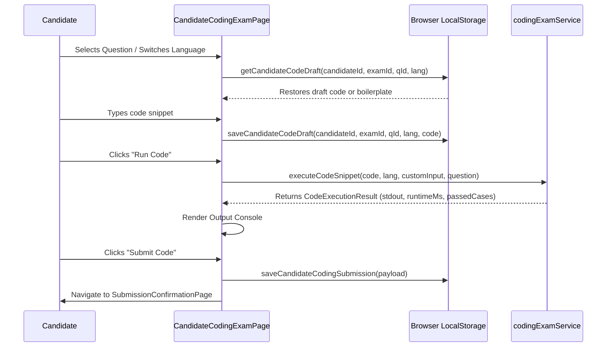

# Round 2: Technical Coding Assessment Page — Technical & Architectural Documentation

> **Document Version:** 1.0.0  
> **Platform:** ExamSecure Enterprise Examination & Proctoring Platform  
> **Target Component:** [`CandidateCodingExamPage.tsx`](file:///d:/Downloads/secureexam/secure-exam-frontend/src/pages/candidate/CandidateCodingExamPage.tsx)  
> **Stylesheet:** [`candidateCodingExam.css`](file:///d:/Downloads/secureexam/secure-exam-frontend/src/styles/candidateCodingExam.css)  
> **Service Layer:** [`codingExamService.ts`](file:///d:/Downloads/secureexam/secure-exam-frontend/src/services/codingExamService.ts) & [`candidateRoundIdService.ts`](file:///d:/Downloads/secureexam/secure-exam-frontend/src/services/candidateRoundIdService.ts)

---

## 1. Executive Summary & Purpose

The **Round 2 Page** ([`CandidateCodingExamPage`](file:///d:/Downloads/secureexam/secure-exam-frontend/src/pages/candidate/CandidateCodingExamPage.tsx)) is the dedicated **Live Technical Coding Assessment IDE** of the ExamSecure platform. 

While Round 1 evaluates candidates on objective Multiple Choice Questions (MCQs), **Round 2** is reserved for technical roles (e.g., *Developer*, *Tester*, *Computer Science & Engineering*), providing a browser-based integrated development environment (IDE) where shortlisted candidates solve algorithmic and system programming challenges under real-time constraints.

### Core Objectives:
- **Zero-Friction In-Browser IDE**: Multi-language support (Java, C++, Python, JavaScript, TypeScript, C#, C) without requiring local compiler setup.
- **Real-Time Code Execution**: On-demand test-case evaluation against public and hidden test cases, with custom input execution.
- **Fail-Safe Crash Resilience**: Continuous per-character draft autosaving across question switching, language switching, or accidental browser reloads.
- **Proctored Countdown & Automated Submission**: Non-tamperable timer with automated submission upon expiration and exit safeguards.

---

## 2. Candidate Journey & Access Control

Access to Round 2 is strictly controlled via candidate credentials and nomination status:

```mermaid
flowchart LR
    A["Round 1 MCQ Assessment"] --> B["Admin Evaluates Results in ResultsPage"]
    B --> C["Admin Selects Candidate for Round 2"]
    C --> D["Unique ID Generated (CODE-XXXX)"]
    D --> E["Email Invitation Dispatched"]
    E --> F["Candidate Enters Portal (CandidateEntryPage)"]
    F --> G["Eligibility Verified via isCandidateSelectedForRound2()"]
    G --> H["Device Compatibility Check (SystemCheckPage)"]
    H --> I["Round 2 IDE (CandidateCodingExamPage)"]
```



1. **Nomination & ID Generation**: The administrator selects top-performing Round 1 candidates from [`ResultsPage.tsx`](file:///d:/Downloads/secureexam/secure-exam-frontend/src/pages/admin/ResultsPage.tsx). The [`candidateRoundIdService.ts`](file:///d:/Downloads/secureexam/secure-exam-frontend/src/services/candidateRoundIdService.ts#L351) assigns a unique ID formatted as `CODE-XXXX` (e.g., `CODE-8492`).
2. **Access Verification**: On [`CandidateEntryPage.tsx`](file:///d:/Downloads/secureexam/secure-exam-frontend/src/pages/candidate/CandidateEntryPage.tsx#L104-L126), candidates input their credentials. If the ID is flagged for Round 2 or matches the `CODE-` prefix:
   - System calls [`isCandidateSelectedForRound2`](file:///d:/Downloads/secureexam/secure-exam-frontend/src/services/candidateRoundIdService.ts#L307).
   - If unauthorized, access is denied with a descriptive security banner.
   - If verified, the candidate profile is provisioned with `assessmentRound: "ROUND_2"`.
3. **Direct Routing**: In [`CandidatePortal.tsx`](file:///d:/Downloads/secureexam/secure-exam-frontend/src/pages/candidate/CandidatePortal.tsx#L88-L96), Round 2 bypasses the MCQ role-application questionnaire and navigates directly to the system compatibility check, entering the coding IDE at route `/candidate/coding`.

---

## 3. UI/UX Layout Architecture

The Round 2 page is structured into a full-viewport, distraction-free **3-Column Workspace** designed to match modern competitive programming environments (LeetCode, HackerRank):

```
+--------------------------------------------------------------------------------------------------+
|  BRAND LOGO (Kalpanaa)   |    PROGRESS BAR (Progress: 1 / 3)    |   TIMER   |  AVATAR  |  EXIT   |
+--------------------------------------------------------------------------------------------------+
|  LEFT NAV (300px)        |  MIDDLE PANEL (Problem Spec)          |  RIGHT PANEL (IDE & Console)   |
|  ----------------------  |  -----------------------------------  |  ----------------------------  |
|  Questions (0/3)         |  Q1 • Easy • Flag for Review          |  [Lang: Java] [Theme] [Screen] |
|  [●] Q1 IP Validation    |  Title: IP Address Validation Regex   |  1 | import java.util.regex.*; |
|  [○] Q2 Target Pair Sum  |  Problem Description & Callout Box    |  2 | class MyRegex { ... }     |
|  [○] Q3 Palindrome Linked|  Example 1: Valid IPs                 |  [ Run Code ]    [ Submit ]   |
|                          |  Example 2: Invalid IPs               |  ----------------------------  |
|                          |  Constraints: Memory / Time           |  Test Output Console           |
|                          |                                       |  ✓ Passed: 3/3 Cases (0.12s)   |
+--------------------------------------------------------------------------------------------------+
```

### 3.1. Top Navigation & Monitoring Header
- **Branding**: Official corporate logo ([`kalpanaaLogo`](file:///d:/Downloads/secureexam/secure-exam-frontend/src/assets/kalpanaa_logo.png)).
- **Progress Gauge**: Visual linear progress bar and textual counter (`Progress: X / Total`) displaying completion status.
- **Countdown Timer Pill**: Monospace digital timer displaying remaining time formatted as `MM : SS`. Automatically turns critical red (`urgent` CSS class with pulse animation) when less than 5 minutes remain.
- **Candidate Identifier Chip**: Displays candidate initials avatar badge, full candidate name, and the registered Unique ID (`CODE-XXXX`).
- **Proctored Exit Safeguard**: Triggers an alert modal warning candidates of unsubmitted work before terminating their session.

### 3.2. Left Column: Question Navigator
- Displays the complete list of assigned programming problems with difficulty indicators (`Easy` in green, `Medium` in amber, `Hard` in red).
- Interactive navigation: Clicking any card switches the active problem without losing written code.
- **Visual Status Tracking**:
  - `Attempted vs. Unattempted` state indicator dot.
  - `Flagged for Review` status badge with amber flag icon.
  - Live fraction counter (`Attempted / Total Questions`).

### 3.3. Middle Column: Problem Specification
- **Top Row**: Problem sequence number, difficulty badge, and "Flag for review" toggle button.
- **Title & Description**: High-visibility problem title and detailed problem statement.
- **Callout Highlight**: Distinct mint-tinted callout container emphasizing formal problem definitions and mathematical rules.
- **Test Case Examples**: Split containers contrasting valid and invalid inputs with expected behavior.
- **Resource Constraints**: Formatted constraints listing character lengths, array bounds, time execution limits (e.g. `2.0 seconds`), and memory quotas (e.g. `256 MB`).

### 3.4. Right Column: Cloud Code Editor & Test Console
- **Language Switcher Toolbar**:
  - Dropdown offering 8 execution targets: Java 17, C++20 (GCC), Python 3.11, Python 2.7, JavaScript (Node.js 20 LTS), TypeScript, C# (.NET 8), and C (GCC 11).
  - Theme switcher button: Toggles between Dark Mode (`#0b0f19` slate background) and Light Mode (`#ffffff`).
  - Fullscreen toggle: Maximizes the workspace for proctoring lockdown.
- **Editor Body**:
  - Synchronized line gutter tracking line counts dynamically based on newline characters (`\n`).
  - Native `Tab` key interception injecting 4-space auto-indentation and maintaining cursor position.
  - Disabled spellcheck and auto-capitalization for coding ergonomics.
- **Action Controls**:
  - **`Run Code`**: Compiles and executes code against sample test cases or custom input.
  - **`Submit Code`**: Displays confirmation modal and records the candidate's final submission.
- **Collapsible Test Output Panel**:
  - Expand/collapse drawer toggle.
  - **Custom Input Sandbox**: Checkbox revealing custom stdin text area for manual debugging.
  - Clear output button.
  - Execution summary chip showing success status, execution time in seconds, and memory consumption.
  - Line-by-line standard output viewer with boolean formatting (`true` in emerald green, `false` in crimson red).

---

## 4. State Management & Lifecycle

The state flow of [`CandidateCodingExamPage.tsx`](file:///d:/Downloads/secureexam/secure-exam-frontend/src/pages/candidate/CandidateCodingExamPage.tsx) is managed locally with persistence hooks to prevent data loss:



### Key State Hooks:

| State Variable | Type | Description |
| :--- | :--- | :--- |
| `questions` | `CodingQuestionDto[]` | Array of coding problems initialized from [`DEFAULT_ROUND2_CODING_QUESTIONS`](file:///d:/Downloads/secureexam/secure-exam-frontend/src/services/codingExamService.ts#L227). |
| `currentQIndex` | `number` | Index of the actively viewed question (0-indexed). |
| `selectedLanguage` | `SupportedLanguage` | Current compiler language identifier (`"java"`, `"cpp"`, etc.). |
| `code` | `string` | The live text content in the editor textarea. |
| `flaggedMap` | `Record<string, boolean>` | Map of question IDs marked for subsequent candidate review. |
| `submittedQuestions` | `Record<string, boolean>` | Map tracking questions that have been attempted or submitted. |
| `outputResult` | `CodeExecutionResult \| null` | Stores standard output, runtime telemetry, and pass/fail statistics. |
| `timeLeft` | `number` | Active countdown in seconds (defaults to `3600` seconds / 60 minutes). |
| `useCustomInput` | `boolean` | Flag enabling the custom stdin debugging box. |
| `customInputText` | `string` | Custom stdin string passed to the execution engine. |

---

## 5. Persistence & Autosave Mechanics

To ensure zero work loss in case of hardware crash, power disruption, or accidental browser closure:

1. **Storage Namespace**: Keyed deterministically per candidate, exam, problem, and language:
   ```typescript
   const key = `examsecure_code_draft_${candidateId}_${examId}_${questionId}_${language}`;
   ```
2. **Boilerplate Fallback**: If no draft exists in `localStorage`, [`getCandidateCodeDraft`](file:///d:/Downloads/secureexam/secure-exam-frontend/src/services/codingExamService.ts#L353) automatically generates a language-specific starter template (e.g. `class MyRegex { ... }` for Java, `class Solution { ... }` for C++, `def solve():` for Python).
3. **Instant Autosave**: On every keystroke, [`handleCodeChange`](file:///d:/Downloads/secureexam/secure-exam-frontend/src/pages/candidate/CandidateCodingExamPage.tsx#L103-L112) updates React state and executes [`saveCandidateCodeDraft`](file:///d:/Downloads/secureexam/secure-exam-frontend/src/services/codingExamService.ts#L368).

---

## 6. Code Execution & Testing Engine

The execution subsystem is encapsulated in [`codingExamService.ts`](file:///d:/Downloads/secureexam/secure-exam-frontend/src/services/codingExamService.ts):

### 6.1. Data Contracts

#### [`CodingQuestionDto`](file:///d:/Downloads/secureexam/secure-exam-frontend/src/services/codingExamService.ts#L54-L70):
Represents a complete problem definition including difficulty, constraints, allowed languages, time/memory quotas, and test cases.

#### [`TestCaseDto`](file:///d:/Downloads/secureexam/secure-exam-frontend/src/services/codingExamService.ts#L44-L52):
```typescript
export interface TestCaseDto {
  id: string;
  label: string;
  input: string;
  expectedOutput: string;
  isHidden: boolean; // false = sample public test case; true = evaluation test case
  marks: number;     // Weightage score
  explanation?: string;
}
```

#### [`CodeExecutionResult`](file:///d:/Downloads/secureexam/secure-exam-frontend/src/services/codingExamService.ts#L320-L327):
```typescript
export interface CodeExecutionResult {
  stdout: string[];
  stderr?: string;
  isSuccess: boolean;
  statusText: string;
  runtimeMs: number;
  memoryMb: number;
  passedCases: number;
  totalCases: number;
}
```

### 6.2. Execution Simulation & Test Case Matching
When [`handleRunCode`](file:///d:/Downloads/secureexam/secure-exam-frontend/src/pages/candidate/CandidateCodingExamPage.tsx#L168-L176) is triggered:
- The function invokes [`executeCodeSnippet`](file:///d:/Downloads/secureexam/secure-exam-frontend/src/services/codingExamService.ts#L430).
- If `useCustomInput` is active, the engine compiles the custom input lines and computes standard output.
- Otherwise, the engine executes the candidate's code against the problem's sample test cases, compares actual output against expected output, calculates runtime in milliseconds, and returns a verified result object.

---

## 7. Submission & Results Pipeline

When a candidate finishes their assessment:

1. **Triggering Finalization**:
   - **Manual**: Clicking **"Submit Code"** opens a confirmation modal detailing total problems attempted.
   - **Automatic**: If the countdown timer hits `0`, [`handleAutoSubmit`](file:///d:/Downloads/secureexam/secure-exam-frontend/src/pages/candidate/CandidateCodingExamPage.tsx#L221) triggers automatically.
2. **Payload Construction**:
   A [`CandidateCodingSubmission`](file:///d:/Downloads/secureexam/secure-exam-frontend/src/services/codingExamService.ts#L329) record is built:
   ```typescript
   {
     id: "SUB-894120",
     candidateId: profile.candidateId,
     candidateName: profile.name,
     registrationNumber: profile.candidateId,
     departmentName: profile.department,
     examId: profile.codingExamId || "CODE-101",
     submittedAt: "2026-10-24T07:15:00.000Z",
     questions: [
       {
         questionId: "q-ip-regex-1",
         questionTitle: "IP Address Validation using Regular Expression",
         language: "java",
         sourceCode: "... candidate code ...",
         passedCases: 4,
         totalCases: 4,
         score: 20,
         maxMarks: 20,
         status: "ACCEPTED",
         runtimeMs: 120
       }
     ],
     totalScore: 75,
     maxScore: 75,
     qualificationStatus: "QUALIFIED"
   }
   ```
3. **Persistence**:
   - Persisted to `localStorage` under `examsecure_coding_submissions_v1`.
   - Forwarded via `onFinalize` callback to [`CandidatePortal.tsx`](file:///d:/Downloads/secureexam/secure-exam-frontend/src/pages/candidate/CandidatePortal.tsx#L204).
   - Candidate is routed to [`SubmissionConfirmationPage.tsx`](file:///d:/Downloads/secureexam/secure-exam-frontend/src/pages/candidate/SubmissionConfirmationPage.tsx), which outputs an immutable cryptographic submission receipt.
4. **Admin Inspection**:
   - Submissions appear live in [`ResultsPage.tsx`](file:///d:/Downloads/secureexam/secure-exam-frontend/src/pages/admin/ResultsPage.tsx#L777) under the **"Round 2 — Coding Submissions"** tab.
   - Administrators can review scores, runtime metrics, test case pass rates, and open the full code inspector modal.

---

## 8. Backend Integration Roadmap

When migrating from frontend mock execution to a cloud code sandbox (e.g., Judge0, Piston, or custom Spring Boot Docker sandbox), map the following REST endpoints:

| Method | Endpoint | Description |
| :--- | :--- | :--- |
| `GET` | `/api/candidate/coding/exam/:id` | Fetch Round 2 questions, constraints, and sample test cases. |
| `POST` | `/api/candidate/coding/run` | Execute code snippet in isolated container with stdin and return stdout. |
| `POST` | `/api/candidate/coding/submit` | Evaluate code against all hidden test cases and record final marks. |
| `GET` | `/api/admin/exams/coding/submissions` | Retrieve candidate submissions and source code for admin review. |

---

## 9. Summary File Reference

- **Page Component**: [`src/pages/candidate/CandidateCodingExamPage.tsx`](file:///d:/Downloads/secureexam/secure-exam-frontend/src/pages/candidate/CandidateCodingExamPage.tsx)
- **Styling**: [`src/styles/candidateCodingExam.css`](file:///d:/Downloads/secureexam/secure-exam-frontend/src/styles/candidateCodingExam.css)
- **Coding Service**: [`src/services/codingExamService.ts`](file:///d:/Downloads/secureexam/secure-exam-frontend/src/services/codingExamService.ts)
- **Eligibility Service**: [`src/services/candidateRoundIdService.ts`](file:///d:/Downloads/secureexam/secure-exam-frontend/src/services/candidateRoundIdService.ts)
- **Portal Router**: [`src/pages/candidate/CandidatePortal.tsx`](file:///d:/Downloads/secureexam/secure-exam-frontend/src/pages/candidate/CandidatePortal.tsx)
- **Entry Gate**: [`src/pages/candidate/CandidateEntryPage.tsx`](file:///d:/Downloads/secureexam/secure-exam-frontend/src/pages/candidate/CandidateEntryPage.tsx)
- **Admin Review**: [`src/pages/admin/ResultsPage.tsx`](file:///d:/Downloads/secureexam/secure-exam-frontend/src/pages/admin/ResultsPage.tsx)
